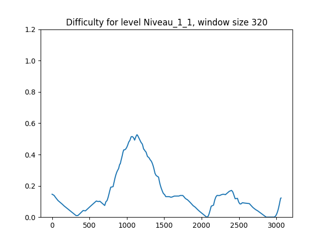

# GameChallengeTools-py
Python version of https://github.com/Iannyck/GameChallengeTools

This is a demo of the algorithm presented in the paper A Comprehensive Model of Automated Evaluation of Difficulty in Platformer Games. This project includes helper function to extrapolate information images and data from mario levels to then process into a difficulty curve. You can find an example implementation in python of the actual algorithm in gamedifficulty/Processing.py, function CalculateDifficulty

## Batch level analysis

Run `python main.py` to analyze level images in parallel. Place images (PNG, JPEG,
BMP, TIFF, or WebP) under `ressources/levels/`; subdirectories are searched
recursively. The generated difficulty graphs and analysis images are saved next
to each source image, with the source filename and extension as a prefix.

For compatibility with the original repository layout, if `ressources/levels/`
does not exist, the script recursively processes files named `level.png` under
`ressources/`.